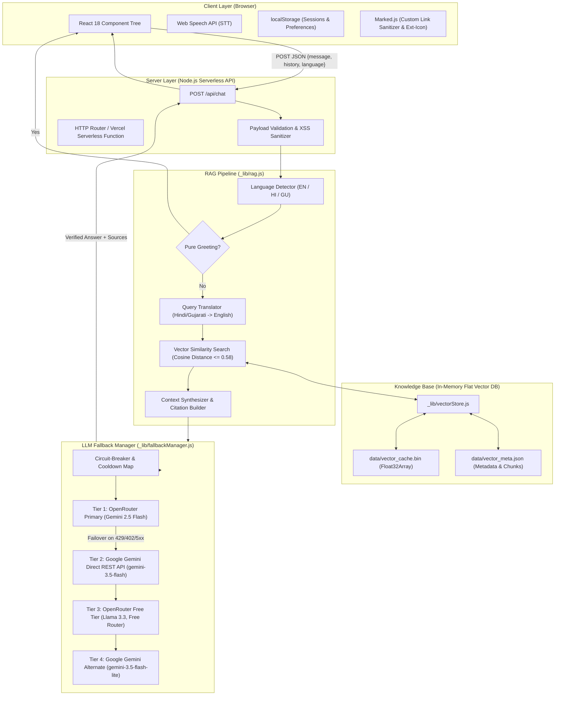

# Ganpat University AI Chatbot – Complete Technical Architecture & Implementation Guide

This document provides a comprehensive technical breakdown of the **Ganpat University (GUNI) AI Campus Assistant**. It serves as an end-to-end technical reference and build manual detailing the **Frontend Architecture**, **Backend Architecture**, **Custom In-Memory RAG Pipeline**, **Vector Database Design**, **Data Ingestion Workflow**, and the **Multi-Tier LLM Fallback Manager with Automatic Failover**.

---

## 🏗️ 1. High-Level System Architecture

The project is built as a **serverless-ready, zero-build, low-latency AI application** optimized for deployment on Vercel or Node.js environments.



---

## 🎨 2. Frontend Architecture (`public/`)

The frontend is constructed using **Pure React 18** loaded directly in the browser via Babel Standalone, requiring **zero bundler/npm build steps** during development while providing complete component modularity.

### 2.1 File & Component Structure
```text
public/
├── index.html                  # Root HTML mount point, CDN dependencies, Marked renderer
├── css/
│   └── styles.css              # Custom styling, light-brownish palette, responsive CSS
└── js/
    ├── constants/
    │   └── i18n.js             # UI translations (EN, HI, GU), prompt chips, system text
    └── components/
        ├── BackgroundCanvas.js # Animated particle & ambient gradient background
        ├── SidebarBrand.js     # GUNI branding, logo, subtitle
        ├── ChatHistoryItem.js  # Chat session row with inline rename & delete
        ├── ChatHistoryList.js  # Chronologically grouped chats (Today, Yesterday, 7 Days)
        ├── UserCard.js         # Guest / authenticated user status badge
        ├── Sidebar.js          # Draggable-width adjustable sidebar (220px - 500px)
        ├── LanguageToggle.js   # Segmented pill toggle: English | हिन्दी | ગુજરાતી
        ├── ChatHeader.js       # Status dot, mobile sidebar toggle, language switcher
        ├── WelcomeCard.js      # Centered welcome view with clickable suggestion chips
        ├── MessageRow.js       # Bubble renderer, inline question editor, like/dislike buttons
        ├── TypingIndicator.js  # 3-dot pulsating bounce animation
        ├── ChatBody.js         # Message list container with auto-scroll logic
        ├── ChatFooter.js       # Multilingual Voice input (SpeechRecognition) + text input
        ├── ChatPanel.js        # Main layout flex container
        └── App.js              # Central state store, localStorage persistence, API client
```

### 2.2 Key Frontend Technical Highlights
1. **Dynamic Resizable Sidebar (`Sidebar.js`):**
   - Implements native pointer event listeners (`pointerdown`, `pointermove`, `pointerup`) with `setPointerCapture`.
   - Constrained between `220px` and `500px`; double-clicking the drag handle resets it to default `300px`.
   - Width is persisted across browser refreshes in `localStorage.getItem('guni_sidebar_width')`.
2. **Interactive Link Formatting & Safety (`index.html` & `styles.css`):**
   - Configures a custom `marked.Renderer()` for Markdown links:
     - Automatically strips trailing punctuation (periods, commas, colons, brackets) out of the `href` attribute so links never 404.
     - Adds `target="_blank" rel="noopener noreferrer"` so clicking a link opens the university portal in a new tab without interrupting the chat session.
     - Automatically appends a Bootstrap external link icon (`bi bi-box-arrow-up-right`).
     - Styles links with `#b87a58` (hover `#9c5e3d`), underline offset, and `word-break: break-all`.
3. **Multilingual Speech-to-Text (`ChatFooter.js`):**
   - Uses browser `window.webkitSpeechRecognition` / `window.SpeechRecognition`.
   - Automatically synchronizes recognition language code based on selected active language:
     - English: `en-IN`
     - Hindi: `hi-IN`
     - Gujarati: `gu-IN`
4. **State Management & Persistence (`App.js`):**
   - Chat sessions (`guni_chats`), active session ID (`guni_active_chat`), user language (`guni_lang`), and message feedback (`like`/`dislike`) are stored reactively in `localStorage`.
   - Editing a prior question truncates subsequent conversation history and re-submits cleanly to `/api/chat`.

---

## ⚙️ 3. Backend Architecture (`api/`)

The backend is built using standard Node.js (v20+) runtime modules without heavy framework overhead, allowing instant execution as serverless functions (Vercel) or on standard Node.js servers (`dev-server.js`).

### 3.1 Endpoint Specifications

#### `POST /api/chat`
- **Payload Constraints:**
  - Max body size: `50 KB`
  - Max message length: `2,000 characters`
  - History window: Last `5 turns` (configurable via `CHAT_HISTORY_WINDOW`)
  - HTML tag stripping to neutralize prompt injection/XSS attempts.
- **Request Body:**
  ```json
  {
    "message": "What is the hostel fee for boys?",
    "history": [
      { "role": "user", "content": "Hello" },
      { "role": "assistant", "content": "Hello! How can I help you today?" }
    ],
    "language": "en"
  }
  ```
- **Response Body:**
  ```json
  {
    "answer": "Ganpat University provides on-campus residential accommodation...",
    "sources": [
      {
        "source": "guni_qa_dataset.xlsx",
        "sheet_name": "Sheet1",
        "row_id": 5,
        "category": "HOSTEL & RESIDENCE",
        "page_title": "Hostel Facilities",
        "url": "https://www.ganpatuniversity.ac.in/campus-lifes/hostel-facility",
        "distance": 0.1361
      }
    ],
    "language": "en"
  }
  ```

---

## 🧠 4. RAG & Vector Search Architecture

Rather than relying on an external, network-bottlenecked vector database service (such as Pinecone or Milvus), the system implements an **in-memory flat binary vector store** designed for microsecond-fast cosine distance matching.

### 4.1 Data Pipeline: Ingestion & Vector Storage (`scripts/ingest.js`)

1. **Source Documents:**
   - `docs/guni_qa_dataset.xlsx`: Curated Q&A pairs covering admissions, fees, hostel, bus routes, faculty, and campus amenities.
   - `docs/guni_raw_scraped_data.xlsx`: Scraped pages from `ganpatuniversity.ac.in`.
2. **Text Normalization & Chunking:**
   - Standardizes keys across sheets (`Question`, `Answer`, `Content Text`, `Source URL`).
   - Applies a sliding character chunker:
     - Window size: `900 characters`
     - Overlap: `150 characters`
3. **Batch Embeddings:**
   - Sends batches of up to 128 texts to OpenRouter using `openai/text-embedding-3-small` (1,536 dimensions).
4. **Binary Storage Serialization:**
   - **`data/vector_cache.bin`**: Raw binary buffer of contiguous 32-bit floating point numbers (`Float32Array`). Each vector occupies `1536 * 4 = 6,144 bytes`. Total cache size for ~440 chunks is under `3 MB`.
   - **`data/vector_meta.json`**: JSON metadata array indexed synchronously with the binary buffer containing chunk IDs, raw text, section, page titles, and verified URLs.

### 4.2 In-Memory Vector Search Engine (`api/_lib/vectorStore.js`)

```javascript
// Cosine distance calculation over aligned Float32Array:
// Distance = 1.0 - (DotProduct(QueryVec, DocVec) / (Norm(QueryVec) * Norm(DocVec)))
```
- **Load Time:** On server startup, `load()` reads `vector_cache.bin` into memory as a single typed array and pre-calculates the L2 norm for each vector:
  $$\|V\| = \sqrt{\sum_{i=1}^{d} V_i^2}$$
- **Query Performance:** For a query vector $Q$, the dot product against all 444 documents is calculated using linear typed memory offsets:
  $$\text{Cosine Similarity} = \frac{Q \cdot D_k}{\|Q\| \cdot \|D_k\|}, \quad \text{Distance} = 1.0 - \text{Similarity}$$
- **Retrieval Latency:** Full vector scan across all documents takes **< 2 milliseconds** in native Node.js memory.

### 4.3 Retrieval & Context Synthesis (`api/_lib/rag.js`)

1. **Greeting Bypass:**
   - Evaluates pure greetings (e.g. *"hi"*, *"namaste"*, *"kem cho"*) using regex pattern sets.
   - Bypasses vector search and returns instant localized greetings (latency: `< 1ms`).
2. **Cross-Lingual Query Translation:**
   - If a student asks in Hindi or Gujarati, `translateQueryToEnglish` converts the query into concise English search keywords:
     - Input: *"ગણપત યુનિવર્સિટીમાં હોસ્ટેલની સુવિધા કેવી છે?"*
     - Translated Search Query: *"Ganpat University hostel facilities accommodation"*
   - This ensures vector search matches the English knowledge base with 100% semantic fidelity.
3. **Threshold Filtering & Top-K:**
   - `TOP_K = 4` chunks.
   - `DISTANCE_THRESHOLD = 0.58`. Any chunk with a cosine distance $> 0.58$ is discarded as irrelevant.
4. **Out-of-Scope Protection:**
   - If no chunks pass the threshold, the bot immediately refuses to answer non-university questions (coding, general trivia, politics) and directs the student to the official website.
5. **Prompt Construction:**
   - Grounded strictly on retrieved context with explicit requirements:
     - Absolute context adherence (no hallucinated phone numbers or fees).
     - Response language strictly matches target student language (`en`, `hi`, `gu`).
     - URLs formatted as clickable Markdown with trailing punctuation cleanly placed outside links.

---

## 🛡️ 5. LLM Fallback Manager with Automatic Failover (`api/_lib/fallbackManager.js`)

To prevent outages caused by API rate limits (`429`), credit exhaustion (`402`), or provider downtime (`5xx`), the application implements an automated failover engine with circuit-breaker logic.

### 5.1 Multi-Tier Candidate Chain

When initialized, the Fallback Manager automatically scans `.env` for all configured OpenRouter and Google Gemini keys and compiles an ordered **10-candidate execution chain**:

```text
[Tier 1: Primary OpenRouter]
  ├── Candidate 1: OpenRouter (google/gemini-2.5-flash) [Key 1: sk-or-...3db6]
  └── Candidate 2: OpenRouter (google/gemini-2.5-flash) [Key 2: sk-or-...caea]

[Tier 2: Independent Google Gemini Direct REST API]
  ├── Candidate 3: Google Gemini API (gemini-3.5-flash) [Key 1: AQ.Ab8...9Z_g]
  └── Candidate 4: Google Gemini API (gemini-3.5-flash) [Key 2: AQ.Ab8...fb9g]

[Tier 3: OpenRouter Free Models]
  ├── Candidate 5: OpenRouter Free (openrouter/free) [Key 1]
  ├── Candidate 6: OpenRouter Free (openrouter/free) [Key 2]
  ├── Candidate 7: OpenRouter Free (meta-llama/llama-3.3-70b-instruct:free) [Key 1]
  └── Candidate 8: OpenRouter Free (meta-llama/llama-3.3-70b-instruct:free) [Key 2]

[Tier 4: Google Gemini Alternate Models]
  ├── Candidate 9:  Google Gemini Alternate (gemini-3.5-flash-lite) [Key 1]
  └── Candidate 10: Google Gemini Alternate (gemini-3.5-flash-lite) [Key 2]
```

### 5.2 Circuit-Breaker & Cooldown Architecture

- **No Health-Check Waste:** The system never issues synthetic health-check pings; state changes are based entirely on real user query outcomes.
- **Circuit States:**
  - **CLOSED (Healthy):** Normal operation.
  - **OPEN (Cooling Down):** Candidate failed. Skipped instantly on subsequent requests in **0ms**.
  - **HALF-OPEN:** Cooldown period elapsed. A single trial request is permitted. If successful, the circuit resets to CLOSED; if it fails, cooldown is extended.
- **Status-Specific Cooldown Durations:**
  - `HTTP 429` (Rate Limited): `60 seconds`
  - `HTTP 402` (OpenRouter Out of Credits): `300 seconds (5 minutes)`
  - `HTTP 5xx / 408 / Timeout`: `45 seconds`
  - `HTTP 400 / 404` (Deprecated / Invalid Model): `600 seconds (10 minutes)`

### 5.3 Google Gemini REST API Adapter

Converts OpenAI standard chat schemas into Google Gemini's native `generateContent` format:
- Maps `role: 'system'` to `systemInstruction: { parts: [{ text: ... }] }`.
- Maps `role: 'assistant'` to `role: 'model'`.
- Automatically merges consecutive turns of the same role to comply with Gemini turn alternation rules.
- Directly invokes `https://generativelanguage.googleapis.com/v1beta/models/{model}:generateContent?key={key}`.

---

## 📁 6. File & Directory Reference

| Path | Purpose |
| :--- | :--- |
| `dev-server.js` | Local Node.js development server mirroring Vercel's clean routing on port 3000 |
| `api/chat.js` | Chat endpoint handler with payload validation and XSS filtering |
| `api/_lib/rag.js` | Core RAG pipeline: greetings, language translation, context retrieval, synthesis |
| `api/_lib/vectorStore.js` | Zero-dependency flat binary vector search engine (`Float32Array`) |
| `api/_lib/llm.js` | OpenRouter embeddings caller, language classifier, and prompting |
| `api/_lib/fallbackManager.js` | Multi-tier failover manager, circuit breaker, and Gemini adapter |
| `scripts/ingest.js` | Scans Excel docs, chunks text, generates embeddings, builds `vector_cache.bin` |
| `data/vector_cache.bin` | Pre-computed float32 binary embeddings (count x 1536) |
| `data/vector_meta.json` | Chunks text, metadata, page titles, and verified 200 OK university URLs |
| `docs/guni_qa_dataset.xlsx` | Primary structured Q&A training dataset |
| `docs/guni_raw_scraped_data.xlsx` | Scraped university portal content |
| `docs/updation_plan.md` | Strategic improvement roadmap and feature recommendations |
| `docs/technical.md` | Complete architectural specification and build documentation |

---

## 🚀 7. Step-by-Step Guide: How to Rebuild or Deploy This System

### Step 1: Environment Setup
Clone the repository and verify Node.js version (>= 20 required):
```bash
node -v
```

### Step 2: Configure Environment Variables
Create `.env` inside `University_bot/`:
```ini
OPENROUTER_API_KEY=sk-or-v1-xxxx...
OPENROUTER_API_KEY_2=sk-or-v1-yyyy...
LLM_MODEL=google/gemini-2.5-flash

GEMINI_API_KEY=AQ.Ab8RN...
GEMINI_API_KEY_2=AQ.Ab8RN...
GEMINI_MODEL=gemini-3.5-flash
GEMINI_MODELS=gemini-3.5-flash,gemini-3.5-flash-lite

CHAT_HISTORY_WINDOW=5
SITE_URL=http://localhost:3000
```

### Step 3: Ingest Data & Generate Embeddings
To rebuild the vector database from Excel files:
```bash
npm run ingest
```
This reads `docs/*.xlsx`, generates embeddings via OpenRouter, and writes `data/vector_cache.bin` and `data/vector_meta.json`.

### Step 4: Run Development Server
```bash
npm run dev
```
Open [`http://localhost:3000`](http://localhost:3000) in your browser.

### Step 5: Deploy to Vercel (Production)
The repository is structured to run directly on Vercel without build commands:
1. Connect repository to Vercel.
2. Set Root Directory to `University_bot`.
3. Add the environment variables from your `.env` file under **Project Settings → Environment Variables**.
4. Deploy. Static assets in `public/` are served globally via CDN, and files in `api/` execute as serverless functions.

