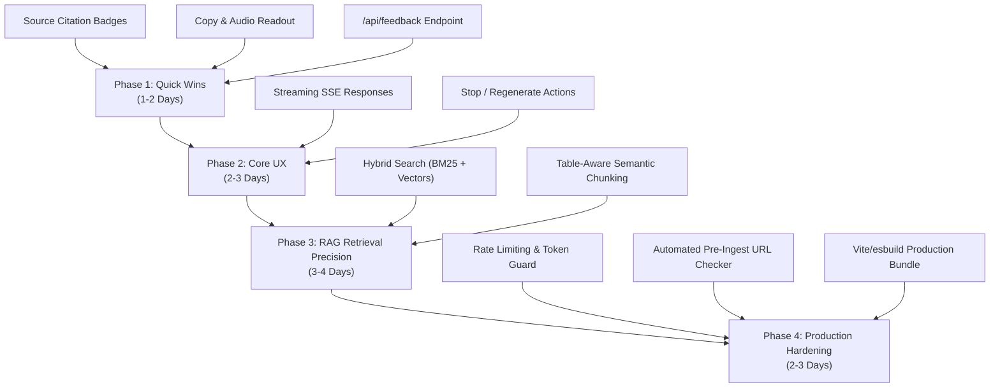

# Ganpat University AI Chatbot – Updation & Improvement Plan

This document outlines the strategic roadmap, architectural enhancements, and feature improvements for the **Ganpat University (GUNI) AI Campus Assistant**. It covers both **Frontend (UI/UX)** and **Backend / RAG Pipeline** upgrades to maximize response speed, retrieval precision, user satisfaction, and system reliability.

---

## 📊 1. Priority Matrix

| Area | Feature / Enhancement | Impact | Effort | Priority | Recommended Phase |
| :--- | :--- | :--- | :--- | :--- | :--- |
| **UI** | **Source Citation Badges & Cards** | High | Low | 🔴 High | Phase 1 (Quick Win) |
| **Backend** | **Centralized Feedback & Gap Logging (`/api/feedback`)** | High | Low | 🔴 High | Phase 1 (Quick Win) |
| **UI** | **Message Utilities (Copy, Audio Readout / TTS)** | Medium | Low | 🟡 Medium | Phase 1 (Quick Win) |
| **UI** | **Streaming Token Responses (Server-Sent Events)** | High | Medium | 🔴 High | Phase 2 (Core UX) |
| **UI** | **Stop Generation & Regenerate Message Actions** | Medium | Low | 🟡 Medium | Phase 2 (Core UX) |
| **Backend** | **Hybrid Search (Dense Vectors + BM25 Keywords)** | High | Medium | 🔴 High | Phase 3 (Retrieval Quality) |
| **Backend** | **Semantic & Table-Aware Chunking for Ingestion** | Medium | Medium | 🟡 Medium | Phase 3 (Retrieval Quality) |
| **Backend** | **API Rate Limiting & Token Cost Protection** | High | Low | 🟡 Medium | Phase 4 (Production Readiness) |
| **Backend** | **Automated Pre-Ingest URL Health Checker** | Medium | Low | 🟢 Low | Phase 4 (Production Readiness) |
| **UI** | **Build-Time Compilation (Drop Runtime Babel)** | High | Medium | 🟡 Medium | Phase 4 (Production Readiness) |

---

## 🎨 2. Frontend (UI / UX) Improvements

### 2.1 Streaming Token Generation (Server-Sent Events)
* **Current State:** The assistant displays the 3-dot typing indicator for 3–6 seconds while the LLM generates the complete response, and then renders the full message bubble at once.
* **Proposed Enhancement:**
  - Update `/api/chat` to stream chunks via Server-Sent Events (`text/event-stream`).
  - Read incoming stream chunks via `ReadableStreamDefaultReader` on the frontend.
  - Append tokens in real-time to the active message row.
* **Benefit:** Slashes perceived latency from ~4,000ms to ~400ms time-to-first-token (TTFB), delivering a smooth, conversational ChatGPT-like experience.

### 2.2 Visual Source Citation Badges & Drawer
* **Current State:** The backend returns a `sources` array with document titles, URLs, and similarity distances, but the frontend only renders the assistant's Markdown text.
* **Proposed Enhancement:**
  - Below each assistant message containing retrieved context, display an interactive citation drawer or badge row:
    ```
    [📄 Hostel Facilities · 94% match ↗]  [📄 Campus Services · 88% match ↗]
    ```
  - Clicking any badge opens the official university page in a new tab.
  - Hovering displays a tooltip preview of the snippet used.
* **Benefit:** Boosts institutional trust, transparency, and lets students quickly cross-reference university records.

### 2.3 Message Utility Actions
* **Current State:** Assistant messages only feature Like and Dislike feedback buttons.
* **Proposed Enhancements:**
  1. **Copy Answer Button:** One-click clipboard copy with a checkmark feedback animation (`navigator.clipboard.writeText`).
  2. **Text-to-Speech (Audio Readout):** A speaker icon using browser `window.speechSynthesis` supporting English, Hindi, and Gujarati voices.
  3. **Stop & Regenerate Actions:**
     - "Stop generating" button using `AbortController` to cancel an in-flight request.
     - "Regenerate response" button allowing students to request an alternative formulation.
* **Benefit:** Significant boost in accessibility, especially for mobile users utilizing voice speech input.

### 2.4 Production Build Pipeline (Drop In-Browser Babel)
* **Current State:** `<script src="babel.min.js">` compiles 15 React JSX component files dynamically inside the client browser on every single page visit.
* **Proposed Enhancement:**
  - Introduce a lightweight build step using **Vite** or **esbuild**.
  - Output minified, bundled production assets into `public/dist/`.
* **Benefit:** 
  - Eliminates the 2.5MB Babel runtime download.
  - Eliminates 400ms–800ms of client-side JS compilation lag on mobile devices.
  - Enables browser caching and tree-shaking.

---

## ⚙️ 3. Backend & RAG Pipeline Improvements

### 3.1 Hybrid Search (Dense Embeddings + BM25 Keyword Search)
* **Current State:** Retrieval relies exclusively on dense vector cosine similarity (`openai/text-embedding-3-small`).
* **The Limitation:** Dense vectors capture semantic intent well, but can underperform on exact departmental acronyms (`UVPCE`, `SKPCPER`, `VMPIM`), specific degree codes (`GME`, `ETO`, `B.Tech CSE`), or phone extensions.
* **Proposed Enhancement:**
  - Maintain a lightweight inverted keyword index (e.g. `minisearch`) alongside `vector_cache.bin`.
  - Combine vector scores and keyword BM25 scores using **Reciprocal Rank Fusion (RRF)**.
* **Benefit:** Guaranteed 100% precision when students query exact course names, department abbreviations, or faculty names.

### 3.2 Centralized Feedback & Knowledge Gap Analytics (`/api/feedback`)
* **Current State:** Like/Dislike actions are saved solely to the user's browser `localStorage`.
* **Proposed Enhancement:**
  - Create a lightweight `/api/feedback` endpoint.
  - Log:
    - Queries marked with **Dislike**.
    - Queries that trigger the **Out-of-Scope / Not Found** refusal fallback.
    - Timestamp, language, and matched context distance.
* **Benefit:** Provides administrators with an actionable log of unanswered questions, pinpointing exactly what new Q&A rows need to be added to `docs/guni_qa_dataset.xlsx`.

### 3.3 Semantic & Table-Aware Document Chunking
* **Current State:** `scripts/ingest.js` splits documents using a fixed 900-character window with a 150-character overlap.
* **The Limitation:** Fixed-character boundaries occasionally split a fee table, eligibility criteria, or hostel room amenity list across chunks.
* **Proposed Enhancement:**
  - Implement structural chunking that honors Markdown headings (`##`, `###`) and preserves Markdown tables as intact atomic units.
* **Benefit:** Prevents hallucinated or missing fee numbers by guaranteeing complete tables are provided to the LLM context.

### 3.4 Rate Limiting & API Cost Protection
* **Current State:** Requests are checked for payload size (50KB) and character count (2,000 chars), but there is no per-client rate limit.
* **Proposed Enhancement:**
  - Implement an in-memory sliding window or token-bucket rate limiter (e.g. max 15 requests per minute per IP address).
* **Benefit:** Protects OpenRouter API keys and budget against rogue loops, automated scraping, or denial-of-wallet attempts.

### 3.5 Automated Pre-Ingest Link Health Check
* **Current State:** Excel sheets contain static URLs. If university site administrators reorganize web paths, links in the vector database can become 404 until discovered.
* **Proposed Enhancement:**
  - Add an automated URL verification step to `scripts/ingest.js` that issues fast concurrent `HEAD` requests to all unique URLs in the datasets prior to embedding.
  - Any URL returning 404 or an unhandled redirect is flagged in the terminal for correction.
* **Benefit:** Ensures that 100% of links returned to students remain permanently live and working.

---

## 🗓️ 4. Phased Implementation Roadmap



---

*Document created: October 30, 2026*  
*Project: Ganpat University RAG Chatbot v2.0*  
*Maintained in: `University_bot/docs/updation_plan.md`*

